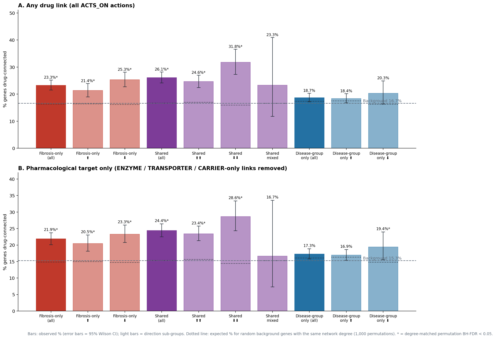

# Paper 2 — Task 3: druggability across progression-gene groups

Gene set: the corrected Paper 1 union of **6,222 genes** (Task 1). "Inflammation" groups are Paper 1's ordered disease-group axis.
**Graph source:** Neo4j (live liver_kg, read-only) (present graph, no CSV fallback). Script: `Paper2_Results/code/task3_druggability.py`.

## Findings (definition B, pharmacological targets; generated from the results below)

Each group against background genes with the same network degree (1,000 permutations; BH-FDR across groups):

- **Fibrosis-associated (fibrosis-only + shared)**: 23.1% drug-connected vs 15.1% expected for degree-matched background genes (fold 1.53; permutation FDR 0.003) → MORE druggable than degree-matched background.
- **fibrosis_only**: 21.9% drug-connected vs 14.9% expected for degree-matched background genes (fold 1.47; permutation FDR 0.003) → MORE druggable than degree-matched background.
- **fibrosis_only_positive**: 20.5% drug-connected vs 15.0% expected for degree-matched background genes (fold 1.37; permutation FDR 0.003) → MORE druggable than degree-matched background.
- **fibrosis_only_negative**: 23.3% drug-connected vs 14.7% expected for degree-matched background genes (fold 1.58; permutation FDR 0.003) → MORE druggable than degree-matched background.
- **shared**: 24.4% drug-connected vs 15.4% expected for degree-matched background genes (fold 1.59; permutation FDR 0.003) → MORE druggable than degree-matched background.
- **shared_positive**: 23.4% drug-connected vs 15.7% expected for degree-matched background genes (fold 1.50; permutation FDR 0.003) → MORE druggable than degree-matched background.
- **shared_negative**: 28.6% drug-connected vs 14.4% expected for degree-matched background genes (fold 1.98; permutation FDR 0.003) → MORE druggable than degree-matched background.
- **shared_discordant_fib_negative**: 16.7% drug-connected vs 15.3% expected for degree-matched background genes (fold 1.09; permutation FDR 0.973) → not different from degree-matched background.
- **inflammation_only**: 17.3% drug-connected vs 16.1% expected for degree-matched background genes (fold 1.07; permutation FDR 0.129) → not different from degree-matched background.
- **inflammation_only_positive**: 16.9% drug-connected vs 16.3% expected for degree-matched background genes (fold 1.04; permutation FDR 0.456) → not different from degree-matched background.
- **inflammation_only_negative**: 19.4% drug-connected vs 14.8% expected for degree-matched background genes (fold 1.31; permutation FDR 0.037) → MORE druggable than degree-matched background.

Pairwise class comparisons (Fisher's exact test, BH-FDR):

- fibrosis_only vs inflammation_only: 21.8% vs 17.3% (OR 1.34; FDR 2.26e-04)
- shared vs inflammation_only: 24.4% vs 17.3% (OR 1.55; FDR 4.76e-08)
- fibrosis_only vs shared: 21.8% vs 24.4% (OR 0.86; FDR 0.060)

Definitions A (any drug) and B (pharmacological target) give the same call for 10 of 11 groups; they differ for: inflammation_only_negative.

## Background used
The background is the **14,794 eligible genes** of Paper 1 (genes measured in all eight studies; `Paper1_HighConfidence/10_loso_all_eligible_runs.csv`). All 6,222 progression genes lie inside it. Drug flags for progression genes match Task 2 exactly.

## Two definitions of "drug-connected"
- **A. Any drug**: ≥1 `Drug-[:ACTS_ON]->Gene` line. Background: 2,467 / 14,794 (16.7%).
- **B. Pharmacological target**: ≥1 line with a pharmacological action: an OptimusKG action other than ENZYME, TRANSPORTER or CARRIER; any curated drug-target line added from ChEMBL, DGIdb, GtoPdb or Open Targets; or an OptimusKG line carrying a GtoPdb/DGIdb/ChEMBL action. Background: 2,261 / 14,794 (15.3%).

Why B is needed: ENZYME/TRANSPORTER/CARRIER lines mostly say the gene **metabolises or moves the drug** (e.g. CYP1A2, CYP2C19, CYP2E1, ABCG2). They do not say the drug acts *on* the gene to change disease biology. Genes that **fall** with fibrosis include many such liver drug-metabolism genes:

| paper1_group | edges | pct_enzyme_transporter_carrier | top enzyme/transporter genes |
|---|---|---|---|
| fibrosis_only_negative | 3675 | 45.2 | ALB, CYP3A5, CYP2C8, SLCO1B1 |
| fibrosis_only_positive | 1865 | 8.4 | ABCC1, PTGS1, ABCC5, NME2 |
| inflammation_only_negative | 625 | 20.8 | CYP1A1, SLC16A1, FPGS, CACNB2 |
| inflammation_only_positive | 2875 | 17.4 | CYP3A7, SLC15A1, SLC22A11, CYP1B1 |
| shared_discordant_fib_negative | 14 | 42.9 | UGT2B10, SCARB1 |
| shared_negative | 2188 | 57.4 | CYP1A2, CYP2C19, ABCG2, CYP2E1 |
| shared_positive | 2922 | 7.6 | ABCC4, PTGS2, SLCO2A1, DCK |

**Definition B is the one to use for repurposing.** A is reported for completeness and comparison with the plan.

## A. Any drug link

| Group | Genes | Connected | % (95% CI) | Drugs | OR (95% CI) | Fisher FDR | Matched exp. % | Fold vs matched | Perm FDR |
|---|---|---|---|---|---|---|---|---|---|
| All progression genes | 6,222 | 1,391 | 22.4 (21.3–23.4) | 5,118 | 2.01 (1.84–2.19) | 2.26e-54 | 16.9 | 1.32 | 0.003 |
| Fibrosis-associated (fibrosis-only + shared) | 3,845 | 947 | 24.6 (23.3–26.0) | 4,326 | 2.03 (1.85–2.22) | 2.92e-49 | 16.5 | 1.49 | 0.003 |
| fibrosis_only | 2,023 | 471 | 23.3 (21.5–25.2) | 2,904 | 1.64 (1.46–1.84) | 4.66e-16 | 16.4 | 1.42 | 0.003 |
| shared | 1,822 | 476 | 26.1 (24.2–28.2) | 2,815 | 1.95 (1.74–2.19) | 2.26e-27 | 16.8 | 1.56 | 0.003 |
| inflammation_only | 2,377 | 444 | 18.7 (17.2–20.3) | 2,057 | 1.18 (1.05–1.32) | 0.006 | 17.4 | 1.07 | 0.101 |
| fibrosis_only_positive | 1,040 | 222 | 21.4 (19.0–23.9) | 1,359 | 1.39 (1.19–1.63) | 7.27e-05 | 16.4 | 1.30 | 0.003 |
| fibrosis_only_negative | 983 | 249 | 25.3 (22.7–28.1) | 2,107 | 1.77 (1.52–2.06) | 1.68e-12 | 16.2 | 1.57 | 0.003 |
| shared_positive | 1,408 | 347 | 24.6 (22.5–27.0) | 1,938 | 1.74 (1.52–1.98) | 2.01e-15 | 17.0 | 1.45 | 0.003 |
| shared_negative | 384 | 122 | 31.8 (27.3–36.6) | 1,479 | 2.40 (1.91–3.00) | 3.78e-13 | 16.0 | 1.99 | 0.003 |
| shared_discordant_fib_negative | 30 | 7 | 23.3 (11.8–40.9) | 14 | 1.52 (0.55–3.67) | 0.326 | 16.6 | 1.40 | 0.436 |
| inflammation_only_positive | 2,042 | 376 | 18.4 (16.8–20.1) | 1,744 | 1.15 (1.02–1.30) | 0.030 | 17.6 | 1.05 | 0.323 |
| inflammation_only_negative | 335 | 68 | 20.3 (16.3–24.9) | 538 | 1.28 (0.96–1.68) | 0.082 | 16.3 | 1.25 | 0.083 |

Pairwise class comparisons (Fisher, BH-FDR):

| Comparison | %A | %B | OR (95% CI) | BH-FDR |
|---|---|---|---|---|
| fibrosis_only vs inflammation_only | 23.3 | 18.7 | 1.32 (1.14–1.53) | 2.89e-04 |
| shared vs inflammation_only | 26.1 | 18.7 | 1.54 (1.33–1.79) | 2.98e-08 |
| fibrosis_only vs shared | 23.3 | 26.1 | 0.86 (0.74–1.00) | 0.043 |

## B. Pharmacological target only (recommended)

| Group | Genes | Connected | % (95% CI) | Drugs | OR (95% CI) | Fisher FDR | Matched exp. % | Fold vs matched | Perm FDR |
|---|---|---|---|---|---|---|---|---|---|
| All progression genes | 6,222 | 1,298 | 20.9 (19.9–21.9) | 4,623 | 2.08 (1.90–2.28) | 3.87e-56 | 15.5 | 1.35 | 0.003 |
| Fibrosis-associated (fibrosis-only + shared) | 3,845 | 887 | 23.1 (21.8–24.4) | 3,795 | 2.09 (1.90–2.30) | 1.93e-50 | 15.1 | 1.53 | 0.003 |
| fibrosis_only | 2,023 | 442 | 21.9 (20.1–23.7) | 2,412 | 1.68 (1.49–1.89) | 6.74e-17 | 14.9 | 1.47 | 0.003 |
| shared | 1,822 | 445 | 24.4 (22.5–26.4) | 2,310 | 1.99 (1.76–2.24) | 2.81e-27 | 15.4 | 1.59 | 0.003 |
| inflammation_only | 2,377 | 411 | 17.3 (15.8–18.9) | 1,765 | 1.19 (1.06–1.34) | 0.005 | 16.1 | 1.07 | 0.129 |
| fibrosis_only_positive | 1,040 | 213 | 20.5 (18.1–23.0) | 1,268 | 1.47 (1.25–1.73) | 4.75e-06 | 15.0 | 1.37 | 0.003 |
| fibrosis_only_negative | 983 | 229 | 23.3 (20.8–26.0) | 1,519 | 1.76 (1.50–2.06) | 1.65e-11 | 14.7 | 1.58 | 0.003 |
| shared_positive | 1,408 | 330 | 23.4 (21.3–25.7) | 1,832 | 1.82 (1.59–2.08) | 6.74e-17 | 15.7 | 1.50 | 0.003 |
| shared_negative | 384 | 110 | 28.6 (24.4–33.4) | 817 | 2.29 (1.81–2.88) | 2.96e-11 | 14.4 | 1.98 | 0.003 |
| shared_discordant_fib_negative | 30 | 5 | 16.7 (7.3–33.6) | 8 | 1.11 (0.33–2.95) | 0.799 | 15.3 | 1.09 | 0.973 |
| inflammation_only_positive | 2,042 | 346 | 16.9 (15.4–18.6) | 1,466 | 1.15 (1.01–1.31) | 0.032 | 16.3 | 1.04 | 0.456 |
| inflammation_only_negative | 335 | 65 | 19.4 (15.5–24.0) | 433 | 1.34 (1.00–1.78) | 0.041 | 14.8 | 1.31 | 0.037 |

Pairwise class comparisons (Fisher, BH-FDR):

| Comparison | %A | %B | OR (95% CI) | BH-FDR |
|---|---|---|---|---|
| fibrosis_only vs inflammation_only | 21.8 | 17.3 | 1.34 (1.15–1.56) | 2.26e-04 |
| shared vs inflammation_only | 24.4 | 17.3 | 1.55 (1.33–1.80) | 4.76e-08 |
| fibrosis_only vs shared | 21.8 | 24.4 | 0.86 (0.74–1.01) | 0.060 |

**Column guide:** % = observed drug-connected fraction (95% Wilson CI). OR/Fisher = group vs rest of background (2×2 Fisher's exact; conditional MLE odds ratio), BH-FDR across the 12 groups. Matched exp. % = mean of 1,000 random background gene sets with the same INTERACTS_WITH degree profile (10 deciles + a degree-0 bin, seed 42). Perm FDR = two-sided empirical p, BH across groups.

## Why degree matters (study bias)
Background genes with more known protein–protein interactions are more likely to have a known drug:

| degree_bin | genes | degree range | pct_any | pct_pharm |
|---|---|---|---|---|
| 0 | 571 | 0–0 | 7.5 | 6.5 |
| 1 | 1423 | 1–3 | 12.4 | 10.0 |
| 2 | 1422 | 3–6 | 13.9 | 11.7 |
| 3 | 1422 | 6–10 | 16.2 | 14.5 |
| 4 | 1422 | 10–15 | 16.6 | 14.9 |
| 5 | 1423 | 15–21 | 16.3 | 15.1 |
| 6 | 1422 | 21–28 | 15.4 | 13.9 |
| 7 | 1422 | 28–38 | 17.2 | 15.9 |
| 8 | 1422 | 38–53 | 16.5 | 15.7 |
| 9 | 1422 | 53–88 | 19.0 | 18.3 |
| 10 | 1423 | 88–5189 | 26.9 | 26.4 |

A raw difference can therefore just mean "better-studied genes". The degree-matched permutation removes this: a group counts as more or less druggable **beyond connectivity** only if its observed % lies outside its degree-matched null.

## Interpretation and caveats
- Percentages describe **representation among known drug targets in the knowledge graph**. They partly reflect which genes scientists have studied and drugged (annotation bias in OptimusKG and the added ChEMBL/DGIdb/GtoPdb/Open Targets links), not biology alone.
- Druggability is not therapeutic relevance. A drug-connected gene is a *repurposing hypothesis entry point*, not evidence a drug would help.
- Groups are kept separate as in Paper 1. The 30 shared genes with discordant direction are reported on their own and are small (wide CIs).
