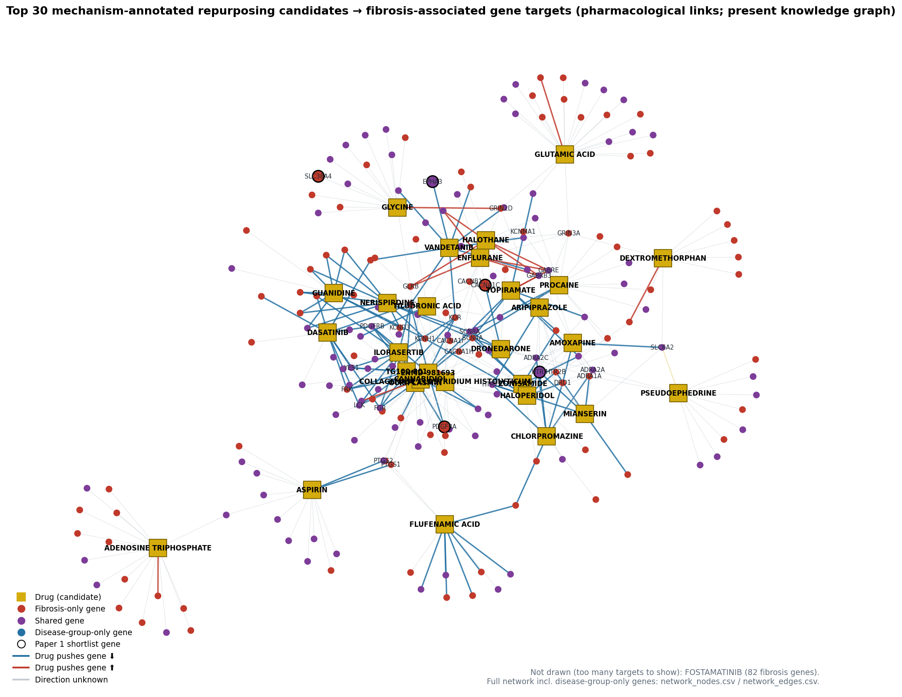

# Paper 2 — Task 4: drug coverage and repurposing candidates

Gene set: the corrected Paper 1 union of **6,222 genes** (Task 1). "Inflammation" columns hold Paper 1's ordered disease-group axis.
**Scope:** knowledge graph only (project scope decision: repurposing, not reversal). Main analysis uses **pharmacological-target links** (same definition as Task 3); any-link gene counts are in `n_progression_genes_any_link`.
Script: `Paper2_Results/code/task4_drug_coverage.py`.

**This is candidate generation only.** Coverage is not a therapeutic score. Broad, heavily annotated drugs (e.g. multi-kinase inhibitors) touch many genes, so `progression_target_fraction` (progression targets / all pharmacological targets in the graph) is reported alongside coverage. No drug here is "the best candidate".

**Exclusion rule:** only drugs already used for a fibrosis-type liver disease are excluded. Fibrosis-type = liver diseases whose name matches *fatty liver, steatohepatitis, cirrhosis, fibrosis, portal hypertension, liver failure* (the Task 5 fibrosis-spectrum definition; 21 of 161 liver diseases, flagged in `liver_disease_set.csv`). Drugs used only for liver cancer, viral hepatitis, bile-duct cancer or other liver diseases are now **kept**: using them for fibrosis is still repurposing.

## From drugs to repurposing candidates

| Step | Drugs |
|---|---|
| Drugs with ≥1 pharmacological link to a progression gene | 4623 |
| …with max_phase ≥ 2 | 3360 |
| …and not withdrawn | 3279 |
| …and no existing FIBROSIS-TYPE liver-disease TREATS/OFF_LABEL_FOR use → **repurposing candidates** | 3163 |
| …of which mechanism-annotated (≥1 link with known action or mechanism text) → **main list** | 2587 |

- Liver disease = `EFO_0001421` "liver disease" + all `PARENT_OF` descendants, **minus 70 non-hepatic-tissue entries** that EFO files under it (malaria, gallbladder / ampulla / extrahepatic bile-duct tumours, erythropoietic porphyrias) = **161 liver diseases**. Both kept and removed entries are listed in `liver_disease_set.csv`. Without this step, antimalarials such as those for *Plasmodium* malaria would be wrongly treated as existing liver drugs.
- 458 drugs hitting progression genes have some liver-disease TREATS/OFF_LABEL_FOR use; only the **118** with a fibrosis-type use are excluded now (reference set in `drug_coverage.csv`).
- 212 candidates are **contraindicated** in a liver disease. They are kept and flagged (`liver_contraindicated`), as requested.
- 213 candidates hit at least one gene in the Paper 1 23-gene shortlist.

## Drugs added to the graph on 21 Oct 2026

These 519 drugs came with drug–gene links only (no TREATS / OFF_LABEL_FOR links). Their existing uses were taken from ChEMBL indications (ChEMBL_37, released 2026-05-01, retrieved 2026-11-03; `added_drug_indications_chembl.csv`), matched by ChEMBL ID or, for RxNorm/GtoPdb/NCIt IDs, by exact name (`added_drug_chembl_ids.csv`). An indication at any clinical phase counts as an existing use. Liver diseases are matched by graph disease ID, or by name for IDs outside the graph's liver set.

| Step | Drugs |
|---|---|
| Added drugs with ≥1 pharmacological progression-gene link | 519 |
| …with a ChEMBL ID (graph ID or exact name match) | 494 |
| …with ≥1 ChEMBL indication | 153 |
| …with a liver-disease indication | 21 |
| …with a fibrosis-type liver indication → excluded | 7 |
| …approved with no phase number, treated as phase 4 | 156 |
| …clinical-trial with no phase number (cannot confirm phase ≥ 2, excluded) | 0 |
| Added drugs among the final candidates | 429 |

## Kept although they have a non-fibrosis liver use (top 20 by fibrosis-gene coverage)

| candidate_order | Drug | phase | n_fibrosis_genes | n_progression_genes | mechanism_annotated | liver_indications |
|---|---|---|---|---|---|---|
| 7 | CANNABIDIOL | 4 | 19 | 29 | True | Autoimmune Hepatitis |
| 9 | NABIXIMOLS | 3 | 16 | 26 | False | liver disease |
| 13 | ASPIRIN | 4 | 13 | 19 | True | alcoholic liver disease; hepatocellular carcinoma |
| 18 | DASATINIB | 4 | 11 | 15 | True | cholangiocarcinoma; hepatocellular carcinoma |
| 22 | TOPIRAMATE | 4 | 10 | 13 | True | liver disease |
| 27 | VANDETANIB | 4 | 9 | 14 | True | hepatocellular carcinoma |
| 37 | CHLORPROMAZINE | 4 | 9 | 10 | True | acute intermittent porphyria |
| 46 | PACLITAXEL | 4 | 8 | 14 | True | biliary tract cancer; cholangiocarcinoma; hepatocellular carcinoma; intrahepatic cholangiocarcinoma; liver cancer |
| 47 | DOCETAXEL ANHYDROUS | 4 | 8 | 14 | True | biliary tract cancer; biliary tract neoplasm; hepatocellular carcinoma; liver cancer |
| 50 | MINOCYCLINE | 4 | 8 | 14 | False | sclerosing cholangitis |
| 52 | REGORAFENIB | 4 | 8 | 10 | True | bile duct carcinoma; biliary tract cancer; cholangiocarcinoma; hepatocellular carcinoma; intrahepatic cholangiocarcinoma |
| 61 | PAROXETINE | 4 | 8 | 9 | False | chronic hepatitis C virus infection |
| 62 | ENMD-2076 | 2 | 7 | 11 | True | hepatocellular carcinoma |
| 63 | IBRUTINIB | 4 | 7 | 9 | True | liver disease |
| 67 | FORETINIB | 2 | 7 | 7 | True | hepatocellular carcinoma |
| 77 | TRETINOIN | 4 | 7 | 8 | True | sclerosing cholangitis |
| 89 | SF-1126 | 2 | 6 | 8 | True | hepatocellular carcinoma |
| 101 | BUPARLISIB | 3 | 6 | 7 | True | liver disease |
| 112 | DOVITINIB | 3 | 6 | 7 | True | hepatocellular carcinoma |
| 113 | MIDOSTAURIN | 4 | 6 | 8 | True | liver disease |

## Main list: top 20 mechanism-annotated repurposing candidates

Ordered by fibrosis-gene coverage, then progression-target fraction. "Mechanism-annotated" means the graph says *how* the drug acts on at least one of its progression-gene targets (inhibitor, agonist, … or a mechanism-of-action text). These are the interpretable candidates.

| mechanism_order | Drug | phase | n_fibrosis_genes | n_progression_genes | pharm_targets_graph | frac | n_down_actions | n_up_actions | shortlist_targets | liver CI | now used for |
|---|---|---|---|---|---|---|---|---|---|---|---|
| 1 | FOSTAMATINIB | 4 | 82 | 131 | 302 | 0.43 | 1 | 0 | EPHA3;PDGFRA;PLK3 |  | Anemia, Hemolytic, Autoimmune; COVID-19; IGA glomerulonephritis |
| 2 | OCRIPLASMIN | 4 | 23 | 25 | 25 | 1.00 | 0 | 0 |  |  | deep vein thrombosis; eye disease; macular degeneration |
| 3 | GLUTAMIC ACID | 3 | 22 | 33 | 61 | 0.54 | 0 | 2 |  |  | Sleep Disorder |
| 4 | CANNABIDIOL | 4 | 19 | 29 | 44 | 0.66 | 4 | 1 |  |  | Autoimmune Hepatitis; Benign essential blepharospasm; COVID-19 |
| 5 | COLLAGENASE CLOSTRIDIUM HISTOLYTICUM | 4 | 16 | 17 | 17 | 1.00 | 0 | 0 |  |  | Dupuytren Contracture; Palmar Fibromatosis; Penile Fibromatosis |
| 6 | ADENOSINE TRIPHOSPHATE | 2 | 16 | 21 | 42 | 0.50 | 0 | 1 |  |  | Alzheimer disease; depressive disorder; major depressive disorder |
| 7 | GLYCINE | 4 | 14 | 16 | 26 | 0.61 | 0 | 1 | SLC38A4 |  | Alzheimer disease; COVID-19; allergic rhinitis |
| 8 | PROCAINE | 4 | 13 | 15 | 22 | 0.68 | 3 | 0 |  |  | HIV infection; hemorrhoid; osteomyelitis |
| 9 | ASPIRIN | 4 | 13 | 19 | 30 | 0.63 | 2 | 0 |  |  | Barrett's esophagus; COVID-19; Disorder of lipid metabolism |
| 10 | ENFLURANE | 4 | 13 | 15 | 55 | 0.27 | 0 | 4 | CACNA1C |  |  |
| 11 | ZONISAMIDE | 4 | 12 | 14 | 32 | 0.44 | 5 | 0 |  |  | Lewy body dementia; Parkinson disease; alcohol abuse |
| 12 | FLUFENAMIC ACID | 4 | 11 | 16 | 16 | 1.00 | 9 | 1 |  |  | rheumatic disease |
| 13 | PSEUDOEPHEDRINE | 4 | 11 | 12 | 19 | 0.63 | 0 | 0 |  | ⚠️ yes | Rhinitis, Allergic, Perennial; allergic conjunctivitis; allergic disease |
| 14 | DASATINIB | 4 | 11 | 15 | 25 | 0.60 | 10 | 0 |  |  | Alzheimer disease; Blast Phase Chronic Myelogenous Leukemia, BCR-ABL1 Positive; Burkitts lymphoma |
| 15 | NERISPIRDINE | 2 | 10 | 12 | 12 | 1.00 | 12 | 0 |  |  | Spinal cord injury; multiple sclerosis |
| 16 | GUANIDINE | 4 | 10 | 12 | 13 | 0.92 | 9 | 0 |  |  | Lambert-Eaton myasthenic syndrome; Myasthenia gravis; metastasis |
| 17 | TILUDRONIC ACID | 4 | 10 | 16 | 29 | 0.55 | 1 | 0 |  |  | bone disease; osteitis deformans; otosclerosis |
| 18 | TOPIRAMATE | 4 | 10 | 13 | 33 | 0.39 | 7 | 2 | CACNA1C |  | Hypertriglyceridemia; Lennox-Gastaut syndrome; Parkinson disease |
| 19 | AMOXAPINE | 4 | 10 | 12 | 44 | 0.27 | 3 | 0 | HTR7 |  | depressive disorder; major depressive disorder |
| 20 | ENMD-981693 | 2 | 9 | 13 | 13 | 1.00 | 13 | 0 | PDGFRA |  | breast cancer; cancer; colorectal carcinoma |

Full list: `repurposing_candidates_mechanism_annotated.csv` (2,587 drugs).

## All candidates, including drugs with no mechanism annotation

Drugs without any mechanism annotation (often nutrients, metal ions or cofactors that OptimusKG lists as binding many enzymes with the generic label "TARGET") are kept for completeness, but are not meaningful repurposing hypotheses without mechanism evidence.

| candidate_order | Drug | phase | n_fibrosis_genes | fib_only_pos | fib_only_neg | shared_pos | shared_neg | n_progression_genes | pharm_targets_graph | frac | n_down_actions | n_up_actions | shortlist_targets | liver CI |
|---|---|---|---|---|---|---|---|---|---|---|---|---|---|---|
| 1 | FOSTAMATINIB | 4 | 82 | 30 | 17 | 30 | 5 | 131 | 302 | 0.43 | 1 | 0 | EPHA3;PDGFRA;PLK3 |  |
| 2 | ZINC ACETATE ANHYDROUS | 4 | 39 | 2 | 23 | 6 | 7 | 49 | 124 | 0.40 | 0 | 0 | F2;KNG1 |  |
| 3 | ZINC CHLORIDE | 4 | 31 | 2 | 18 | 5 | 5 | 41 | 97 | 0.42 | 0 | 0 | KNG1 |  |
| 4 | OCRIPLASMIN | 4 | 23 | 2 | 2 | 18 | 1 | 25 | 25 | 1.00 | 0 | 0 |  |  |
| 5 | GLUTAMIC ACID | 3 | 22 | 2 | 10 | 4 | 6 | 33 | 61 | 0.54 | 0 | 2 |  |  |
| 6 | PYRIDOXAL PHOSPHATE ANHYDROUS | 3 | 20 | 1 | 9 | 2 | 8 | 23 | 49 | 0.47 | 0 | 0 | OAT |  |
| 7 | CANNABIDIOL | 4 | 19 | 6 | 4 | 4 | 5 | 29 | 44 | 0.66 | 4 | 1 |  |  |
| 8 | COLLAGENASE CLOSTRIDIUM HISTOLYTICUM | 4 | 16 | 1 | 2 | 12 | 1 | 17 | 17 | 1.00 | 0 | 0 |  |  |
| 9 | NABIXIMOLS | 3 | 16 | 5 | 4 | 3 | 4 | 26 | 41 | 0.63 | 0 | 0 |  |  |
| 10 | ADENOSINE TRIPHOSPHATE | 2 | 16 | 5 | 6 | 3 | 2 | 21 | 42 | 0.50 | 0 | 1 |  |  |
| 11 | GLYCINE | 4 | 14 | 2 | 5 | 0 | 7 | 16 | 26 | 0.61 | 0 | 1 | SLC38A4 |  |
| 12 | PROCAINE | 4 | 13 | 3 | 4 | 2 | 4 | 15 | 22 | 0.68 | 3 | 0 |  |  |
| 13 | ASPIRIN | 4 | 13 | 3 | 0 | 8 | 2 | 19 | 30 | 0.63 | 2 | 0 |  |  |
| 14 | ENFLURANE | 4 | 13 | 5 | 3 | 4 | 1 | 15 | 55 | 0.27 | 0 | 4 | CACNA1C |  |
| 15 | ZONISAMIDE | 4 | 12 | 3 | 4 | 1 | 4 | 14 | 32 | 0.44 | 5 | 0 |  |  |
| 16 | FLUFENAMIC ACID | 4 | 11 | 3 | 3 | 3 | 2 | 16 | 16 | 1.00 | 9 | 1 |  |  |
| 17 | PSEUDOEPHEDRINE | 4 | 11 | 2 | 2 | 7 | 0 | 12 | 19 | 0.63 | 0 | 0 |  | ⚠️ yes |
| 18 | DASATINIB | 4 | 11 | 4 | 2 | 4 | 1 | 15 | 25 | 0.60 | 10 | 0 |  |  |
| 19 | NERISPIRDINE | 2 | 10 | 4 | 4 | 1 | 1 | 12 | 12 | 1.00 | 12 | 0 |  |  |
| 20 | GUANIDINE | 4 | 10 | 3 | 5 | 2 | 0 | 12 | 13 | 0.92 | 9 | 0 |  |  |

Full list: `repurposing_candidates.csv` (3,163 drugs, with current indications, target genes, cluster counts and action counts).

## Top 15 drugs by raw progression-gene coverage (all drugs, incl. existing liver drugs)

| Drug | max_phase | n_progression_genes | n_fibrosis_genes | inflammation_only_targets | pharm_targets_graph | frac | liver use |
|---|---|---|---|---|---|---|---|
| FOSTAMATINIB | 4.0 | 131 | 82 | 49 | 302 | 0.43 |  |
| CHEMBL1201279 |  | 50 | 40 | 10 | 125 | 0.40 |  |
| ZINC ACETATE ANHYDROUS | 4.0 | 49 | 39 | 10 | 124 | 0.40 |  |
| ZINC CHLORIDE | 4.0 | 41 | 31 | 10 | 97 | 0.42 |  |
| GLUTAMIC ACID | 3.0 | 33 | 22 | 11 | 61 | 0.54 |  |
| CANNABIDIOL | 4.0 | 29 | 19 | 10 | 44 | 0.66 | yes |
| NABIXIMOLS | 3.0 | 26 | 16 | 10 | 41 | 0.63 | yes |
| PHENETHYLISOTHIOCYANATE |  | 26 | 14 | 12 | 44 | 0.59 |  |
| OCRIPLASMIN | 4.0 | 25 | 23 | 2 | 25 | 1.00 |  |
| PYRIDOXAL PHOSPHATE ANHYDROUS | 3.0 | 23 | 20 | 3 | 49 | 0.47 |  |
| ADENOSINE TRIPHOSPHATE | 2.0 | 21 | 16 | 5 | 42 | 0.50 |  |
| CHEMBL384759 |  | 21 | 5 | 16 | 36 | 0.58 |  |
| ASPIRIN | 4.0 | 19 | 13 | 6 | 30 | 0.63 | yes |
| SODIUM beta-NICOTINAMIDE ADENINE DINUCLEOTIDE PHOSPHATE |  | 19 | 12 | 7 | 30 | 0.63 |  |
| OPROZOMIB | 2.0 | 19 | 3 | 16 | 19 | 1.00 | yes |

Full top 50: `top50_by_coverage.csv`.

## Drugs that already have a fibrosis-type liver use (reference, not candidates)

| Drug | max_phase | n_fibrosis_genes | n_progression_genes | fibrosis_type_liver_uses |
|---|---|---|---|---|
| CAFFEINE | 4.0 | 11 | 13 | non-alcoholic steatohepatitis |
| SPIRONOLACTONE | 4.0 | 10 | 14 | cirrhosis of liver; non-alcoholic steatohepatitis |
| RESVERATROL | 3.0 | 10 | 12 | non-alcoholic fatty liver disease |
| ALCOHOL | 4.0 | 10 | 11 | cirrhosis of liver |
| PENTOXIFYLLINE | 4.0 | 8 | 9 | cirrhosis of liver; non-alcoholic steatohepatitis; primary biliary cirrhosis |
| GABAPENTIN | 4.0 | 7 | 9 | cirrhosis of liver |
| ERGOCALCIFEROL | 4.0 | 7 | 9 | non-alcoholic fatty liver disease |
| ORNITHINE | 3.0 | 5 | 5 | cirrhosis of liver |
| SORAFENIB | 4.0 | 5 | 8 | portal hypertension |
| ICOSAPENT | 3.0 | 5 | 7 | non-alcoholic fatty liver disease |

## Network
`network_nodes.csv` / `network_edges.csv` (Cytoscape-ready): top 30 candidates → their progression-gene targets (368 genes, 565 links). Gene attributes: class, direction, trajectory cluster, main Paper 1 pathway (Hallmark > Reactome > KEGG > GO, most significant), shortlist flag. Drug attribute: is_approved. Edge attribute: action direction.

## Caveats
- Coverage counts known drug–target annotations, which favour well-studied drugs and genes.
- Most links have unknown push direction (Task 2). Whether a candidate's action opposes the fibrosis direction is checked in Task 7.
- "No fibrosis-type liver use" means none is recorded in the graph (or, for added drugs, in ChEMBL), not necessarily none in practice.
- Candidates are **repurposing hypotheses**, not treatments.
